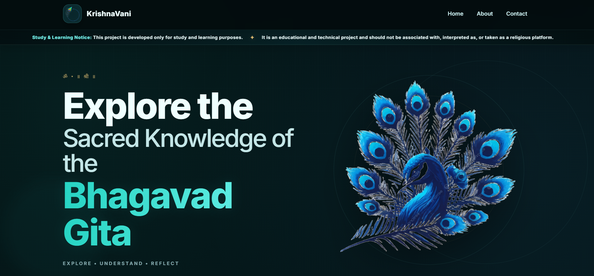

<div align="center">

# KrishnaVani

A simple Flask website for exploring Bhagavad Gita shlokas, finding verses, and reading daily wisdom.

<a href="https://krishnavani-ai.onrender.com/" target="_blank" rel="noopener noreferrer">
  
</a>

<br><br>



</div>

## What it includes

- **Verse Navigator** — find a shloka by chapter and verse.
- **Daily Gita Wisdom** — displays a random verse and lets you reveal another.
- **Read Shlok** — uses the browser's built-in text-to-speech feature to read a displayed shloka aloud.
- **Shloka search** — search the source text for a word or phrase and view matching passages.
- **Translation support** — uses `googletrans` in the `/Generate` route.
- **About and Contact pages** — information about the project and a contact form interface.

This is a study and learning project. It is intended for educational and technical exploration, not as a religious platform.

## Built with

- Python 3.12
- Flask
- HTML, CSS, and JavaScript
- NumPy
- `googletrans`
- Gunicorn

## Project structure

```text
KrishnaVani/
├── app.py
├── geetamain1.txt
├── requirements.txt
├── requirements-training.txt
├── .python-version
├── shloka_model.h5
├── tokenizer.pkl
├── sv.py
├── templates/
│   ├── home.html
│   ├── nav.html
│   ├── verse.html
│   ├── daily_thro.html
│   ├── index.html
│   ├── translate.html
│   ├── about.html
│   └── contact.html
├── static/
│   ├── css/
│   └── js/
└── assets/
    └── krishnavani-home.png
```

## Run it on your computer

You need Python 3.12 and Git installed.

1. Open a terminal in the project folder.
2. Create a virtual environment:

   ```bash
   python -m venv .venv
   ```

3. Activate it.

   **Windows PowerShell:**

   ```powershell
   .\.venv\Scripts\Activate.ps1
   ```

   **macOS/Linux:**

   ```bash
   source .venv/bin/activate
   ```

4. Install the website dependencies:

   ```bash
   python -m pip install --upgrade pip
   pip install -r requirements.txt
   ```

5. Start the app:

   ```bash
   python app.py
   ```

6. Open [http://127.0.0.1:5000](http://127.0.0.1:5000) in your browser.

If PowerShell blocks virtual-environment activation, use Command Prompt:

```bat
.venv\Scripts\activate.bat
```

## A note about the model files

The repository includes `sv.py`, `shloka_model.h5`, and `tokenizer.pkl` from the model experiments. The current Flask request handlers do not load the saved model to make live predictions; the `/Generate` route currently searches the source text for matching passages. `requirements-training.txt` is kept separately for the training environment, while `requirements.txt` is for running the website.

## Current limitations

- Translation depends on the external `googletrans` service and may fail if that service is unavailable.
- The Contact form does not currently send email or save messages to a database.
- The live site is hosted on Render's free web service, which may take a little time to respond after inactivity.

## License

This project was made for learning and demonstration. Add a specific open-source license before allowing others to reuse or distribute the code.
